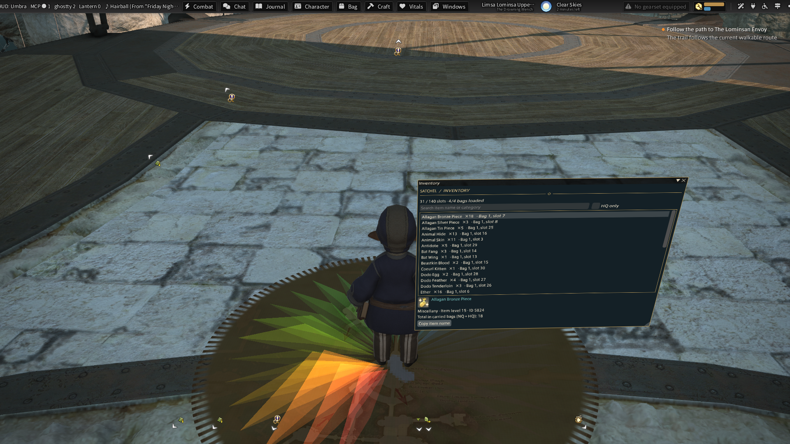

# XivHud family

Nine independently loadable Dalamud API 15 plugins, with shared illustration, controller and window hosting code. Source is collected here so a checkout builds the family without sibling repositories.

| Part | Purpose | Publication |
| --- | --- | --- |
| XivHud | Reversible native HUD visibility and focused controller broker | Experimental testing package |
| XivHud.Journal | Illustrated accepted-quest journal, local bookmarks, native map handoff, compact quest tracker | Experimental testing package |
| XivHud.Character | Illustrated equipment, attributes, jobs and gear-set record | Manual development package; live acceptance pending |
| XivHud.Vitals | Passive player, target, focus-target, party and optional status-effect HUD panels | Manual development package; live acceptance pending |
| XivHud.Combat | Saved hotbar deck, cooldowns, casts, effects and generic job resources | Manual development package; live acceptance pending |
| XivHud.Chat | Conversations, explicit message composer and session notification center | Manual development package; live acceptance pending |
| XivHud.Inventory | Searchable carried bags, HQ filtering and item details | Development package; live acceptance pending |
| XivHud.Crafting | Recipe browser and shared-material session worklist | Development package; live acceptance pending |
| XivHud.Windows | Independent floating plugin windows with screen recovery | Development package; live acceptance recorded separately |
| XivHud.Windowing / Windowing.Dalamud | Screen layout, optional native frames and Ghostty hosts | Bundled libraries, no installer entry |
| XivHud.Protocol | Versioned cached status and queued UI operations | Bundled library |

Journal and Character work with mouse and keyboard without XivHud. The optional XivHud broker handles only focused local windows. KamiToolKit supplies native frames; Ghostty supplies optional world hosting. Each plugin has its own settings and lifecycle.

Vitals is the first persistent field HUD module. It works independently of XivHud,
Journal, Character, Umbra, Ghostty and KamiToolKit. Locked panels pass clicks
through and never acquire controller input. It starts disabled; `/xivvitals preview`
shows labelled sample data, including while logged out, and `/xivvitals open`
enables live readings. Native hotbars and job gauges remain necessary. Vitals does
not suppress the native HUD. See [Vitals](xivhud-vitals/README.md).

Add `https://spacegho.st/mods/ffxiv/plugins.json` as an experimental repository and enable testing builds for HUD and Journal. Do not install Character from the automatic listing: its release asset is explicitly marked `dev`, pending first live acceptance. See the [family site](https://spacegho.st/mods/ffxiv/xivhud/).

## Build and package

Requires Python 3, .NET SDK 10.0.401, and the reviewed Dalamud 15.0.3.6 reference assemblies. Reference hashes are checked before compiling native consumers. Build tools refuse different bindings rather than silently targeting a later game version.

```sh
tools/fetch-dalamud.sh
tools/build.sh --test --locked
tools/package.sh
```

For local references: `tools/build.sh --references /path/to/reviewed/dalamud --test --locked`. `--offline-feed /path/to/nuget/cache` is available for offline builds. Dependencies have committed NuGet lock files. Release ZIPs use sorted entries and the source commit timestamp; rerunning packaging for the same outputs produces identical checksums. `release/build-info.json` records the source and reference hashes. Game-provided DLLs are excluded. Nine ZIPs are built, but only HUD and Journal appear in `pluginmaster-testing.json`.

CI runs builds and all eleven offline suites against the reviewed references and uploads packages. A separate manually dispatched release workflow publishes the `testing` channel from `master` after the same checks. No build starts the game or uploads player data. Character and Vitals remain development assets outside the normal automatic listing. An explicit development repository can install them through MCP without manual setup; live acceptance is still pending.

## Controls and recovery

- `/xivhud on` hides native HUD categories; `/xivhud off` restores them. `/xivhud` opens settings. Defaults off and preserves saved native layouts.
- `/xivjournal` opens Journal; `/xivjournal native` opens the original; `/xivjournal screen` recovers the normal screen window.
- `/xivcharacter` opens Character; `/xivcharacter native` opens the original; `/xivcharacter screen` recovers its screen window.
- `/xivvitals settings` opens Vitals appearance; `preview` shows sample panels; `open` enables live panels; `close` hides them; `lock` enables click-through.
- Journal Appearance configures the compact tracker; `/xivjournal tracker` enables it and `tracker off` hides it.
- Journal and Character can choose screen, native frame, or independent floating hosting, with an explicit Ghostty option. Requested mode and actual presentation are separate diagnostics.

Full module documentation: [HUD](xivhud-dalamud/README.md), [Journal](xivhud-journal/README.md), [Character](xivhud-character/README.md), [Vitals](xivhud-vitals/README.md), [Windowing](xivhud-windowing/README.md). Their earlier verification records describe those checks, not acceptance of this publication build.

## MCP integration

[XivMcp](https://github.com/Spaceghost/xivmcp-dalamud) discovers the modules independently, reads immutable snapshots and capabilities, and exposes explicitly approved UI controls. Reads never open a window or acquire controller input. UI requests are queued for the framework thread; poll their result and then inspect actual window state. The remote Character page control never equips gear. See [IPC contract](docs/IPC.md).

All 548 tests across eleven offline suites pass. The nine modules and eight optional Umbra adapters also loaded in game. Standalone Journal hosting and popups, Inventory clicks and beside-character placement, screen recovery, and Crafting worklists were checked live. See the [acceptance record and screenshots](docs/WORLD-WINDOWS-ACCEPTANCE.md) for evidence and remaining limits. Character remains a development build pending its broader native, data and physical-controller acceptance.



## License

MIT. [Third-party notices](THIRD-PARTY-NOTICES.md) include the bundled KamiToolKit license. Game artwork is loaded from the local game installation.

## Automatic development setup

The explicit development catalogue contains Character, Vitals and the Journal
tracker preview:
`https://github.com/Spaceghost/xivhud-dalamud/releases/download/development/pluginmaster-development.json`.
With a current XivMcp server, call `setup_plugins` with `plugins` set to
`["XivHud.Character", "XivHud.Vitals"]`, this `repositoryUrl`, and `channel` set
to `testing`; poll `get_plugin_setup_status` with the returned id. MCP registers
the repository, configures testing, installs the bundled libraries, enables the
plugins and verifies loaded versions. Source builds and game acceptance remain
separate concerns. The normal testing catalogue still excludes development modules.

## Umbra UI family

[The Umbra family](https://spacegho.st/mods/ffxiv/umbra/) gathers HUD, Journal, Character, Vitals, Combat and Correspondence. Journal, Character, Combat and Chat have optional `Umbra.XivHud.*` toolbar adapters. The Dalamud modules provide game data and UI; Umbra plugins supply toolbar controls. Build adapters with `--umbra-references /path/to/installed/Umbra`; packaging includes separate adapter DLLs.

## Shared mod workspace

`/xivnav` opens the searchable mod shell for HUD modules, other installed mods
and Ghostty world panels. It supports keyboard/controller selection and explicit
focus, recovery and placement actions. See the [complete UI rewrite roadmap](docs/UI_REWRITE.md).

Combat and chat are implemented as development modules: `/xivcombat` opens its settings, `open` enables the deck and `preview` shows non-interactive sample data. See [Combat](xivhud-combat/README.md). `/xivchat open` enables conversations and notifications; `preview` uses sample data. See [Chat](xivhud-chat/README.md).

## Items and crafting

`/xivinventory` opens the satchel, and `/xivcrafting` opens Workshop. Both appear
in `/xivnav`, use the shared illustrated style and local game data, and support
`preview` and `close`. They are packaged as development modules. See
[Inventory](xivhud-inventory/README.md) and [Crafting](xivhud-crafting/README.md)
for coverage and acceptance limits. These additions do not complete the full UI
rewrite: exploration, layout editing, full item workflows, bespoke job gauges and
live controller acceptance remain.

## Independent floating windows and the Umbra family

`/xivwindows` opens the standalone floating-window manager. Select an open plugin
window and float it beside the character, in view, here in the world or on the
ground. `/xivwindows screen` recovers all sources. This host creates no Ghostty
terminal sessions. Ghostty remains an explicit provider for its existing terminal
and remote-window experience. Journal and Character default to the independent
host for world presentation and retain an appearance setting for Ghostty.

Optional Umbra toolbar plugins now cover Journal, Character, Combat, Chat, Vitals,
Inventory, Crafting and Floating Windows. Build them with
`tools/build.sh --umbra-references /path/to/Umbra`; packaging includes their DLLs
as separate release assets. The content modules remain independently loadable
Dalamud plugins and do not require Umbra. See [Floating Windows](xivhud-windows/README.md)
and the [acceptance record](docs/WORLD-WINDOWS-ACCEPTANCE.md).
